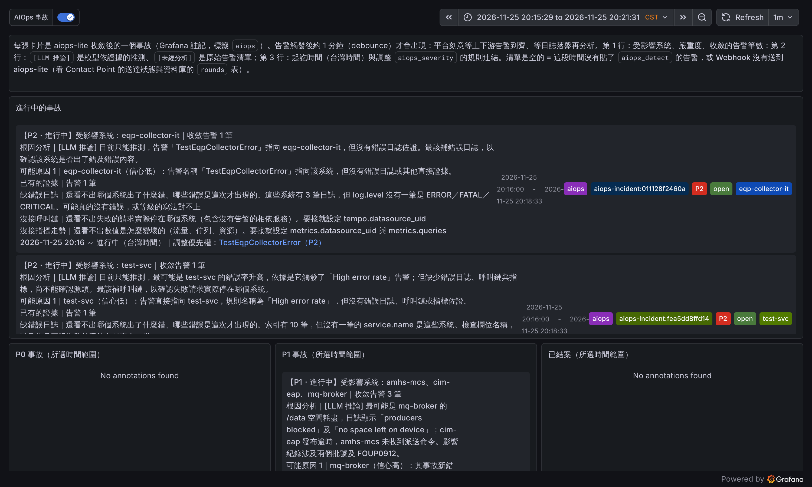

# aiops-lite

事件驅動的極簡 AIOps：Grafana 告警經 Webhook 推進來 → 等一段 debounce → 跨系統收斂 → 收集證據交給 LLM → 寫回 Grafana 註記。
只拿一把 Grafana Editor Token，不直連任何外部資料庫／ES，沒有前端。

這個 repo 現在只有 aiops-lite。原本的 aiops-platform（管線加可插拔算子的那一版：`aiops/`、它的測試、腳本、Helm chart、
資料庫遷移）已經從這個分支移除；要找舊程式請看 Git 歷史。

```
MQ / CIM / AMHS ──▶ 公司 Grafana（資料源 + 貼標籤的告警規則）
                          │ 告警 firing／resolved
                          ▼ Webhook（Contact Point）
┌──────────────────── aiops-lite（常駐服務，1 個副本）────────────────────┐
│ 收 Webhook → 先存資料庫 → 等 debounce（預設 60 秒，YAML 可調）            │
│   → 1 收斂（同系統、關係邊）→ 2 收集證據（最多 7 包）→ 3 LLM → 4 寫註記          │
│ 有進行中事故時每 followup 秒續跑一輪，直到全部 resolved 並安靜夠久才結案   │
└──────────────────────────────┬──────────────────────────────────────────┘
                               ▼ config.yaml 的 grafana.url + grafana.token
            Grafana Annotations（摘要＋證據）+「AIOps 事件總覽」儀表板
```

部署物：1 個常駐 Deployment（+ Service）、1 個帶 PVC 的 PostgreSQL、1 個放整份 config.yaml 的 Secret（`deploy/helm/aiops-lite`）。

**什麼算異常由各系統自己的 Grafana 告警規則決定**：規則 firing 就是異常，平台不重放查詢、不自己判數值（原本的 5 個偵測器已拿掉）。

**全部的輸入與輸出、每一項的最低要求與最理想的狀態，見 `INPUTS.md`。**

## 工廠與傳統可觀測性一起用

三種訊號各走各的路，最後合成同一份證據交給 LLM：

| 訊號 | 工廠（老舊系統、沒有埋點） | IT 服務（有埋點） | aiops-lite 怎麼用 |
| --- | --- | --- | --- |
| 指標 | 日誌轉指標（Grafana 規則對 ES 算次數） | 原生 metrics（Prometheus、VictoriaMetrics） | 兩者都是 Grafana 告警，Webhook 進來的格式一樣 |
| 關聯 | **批號／載具**把各系統的日誌串成時間線 | **trace id** 向 Tempo 取回呼叫鏈 | 證據第 5 包（時間線）、第 6 包（呼叫鏈） |
| 日誌 | ES | ES | 證據第 3、4 包（錯誤日誌樣本、識別碼出現次數） |

- **批號時間線**：從錯誤日誌裡挑出現最多次的批號與載具，回 ES 把它們在各系統的紀錄（不限等級、不限系統）照時間排出來。
  它只說明先後，不說明因果；靠各系統的時間戳排序，系統之間時鐘差幾秒，順序就可能是錯的。
- **Tempo 呼叫鏈**：經 Grafana 的 Tempo 資料源取回失敗請求的整條呼叫路徑，標出「底下沒有其他失敗呼叫」的那個失敗點。
  錯誤日誌帶 trace id（`tempo.trace_id_field`）時直接用編號取；沒有才用 TraceQL 搜尋。
- **同一張事故**：工廠與 IT 服務的告警只要關係邊連得起來（例如 `[mes-api, cim-eap]`）就併成一張。兩邊的日誌要用同一套欄位名稱。
- **呼叫鏈裡出現的系統算有憑據**：例如呼叫鏈指到一個沒有告警、也不在關係邊裡的資料庫，LLM 可以點名它；憑空編的系統照樣被擋。

- **指標走勢**（第 7 包，選用）：事故時經 Grafana 的 Prometheus 相容資料源查各系統的數值（`metrics.queries` 設定的查詢），
  壓成「事故前的基準、事故後的最小／最大／最後值、相對基準的倍數」。只做算術、沒有門檻，不判斷算不算異常。
  它補的是日誌與 Trace 看不到的情況，例如 MQ 的消費者不見了、流量暴增。

設定：`es.timeline_fields`、`tempo.datasource_uid`、`metrics.*` 等，見 `CONFIG.md`。Loki、Jaeger 沒有接。
要抓「還沒超標但走勢不對」，在 Grafana 規則用變化率、預測、跟之前比這類查詢，寫法與實測值見 `INPUTS.md`；平台本身不做異常偵測。

## 整合的單位：以 `service` 為準，一個 Grafana 一份

**事故以 `service`（系統名稱）為單位收斂，不是以 cluster、namespace、pod 或機台。**
收斂只看三樣東西：告警上的 `service` 標籤、設定檔的 `edges`、目前有沒有進行中的事故。告警上其他的標籤收斂時都不看；
機台、批號、pod 這類識別碼只出現在日誌裡，用來統計與做時間線，不影響事故怎麼分。

| 情況 | 結果 |
| --- | --- |
| 兩個 cluster 都有叫 `mes-api` 的服務，各自告警 | **併成同一張事故**（`service` 的值一樣） |
| 同一個服務有幾十個 pod 各自告警 | 併成一張，pod 不會獨立成事故 |
| 同一個系統底下好幾台機台各自告警 | 併成一張，機台只出現在日誌統計裡 |

**部署單位**：一個 aiops-lite 對一個 Grafana，只用一把 Grafana Token、收該 Grafana 送來的 Webhook，而且只能跑 1 個副本。
不是一個 cluster 一份，也不是一個服務一份。有多個廠區或 cluster 各有自己的 Grafana 時，要各部署一份。

**多個 cluster 或廠區共用同一個 Grafana 時**，有三種做法：

1. **把 cluster 寫進 `service` 的值**（例如 `prod-a/mes-api`）：不用改程式；代價是 `edges` 也要照這個名稱寫，邊會變多，日誌的 `service.name` 也要一致。
2. **每個 cluster 各部署一份 aiops-lite**，各自用該 cluster 的告警路由（通知路由的條件要多一個 cluster 標籤）：隔離最乾淨，要多維護幾份。
3. **讓收斂把 cluster 標籤也算進去**：要改程式，**目前沒有做**。

要在上線前決定用哪一種，因為選了之後 `service` 的命名與 `edges` 都要照著寫。

**沒有驗證的**：多個 Grafana 組織（org）的情況。Token 是某個組織底下的服務帳號，推測它收不到其他組織的註記與資料源，
Webhook 內容裡雖然帶組織編號，但程式不看；這些都是依 Grafana 的一般行為推測，沒有在多組織環境實測過。
另外兩個 cluster 同名服務會併成一張，這點是依收斂邏輯與測試確認的，沒有用真實多 cluster 資料跑過。

### 改用別的單位分析（function、cluster）

分析單位其實是「告警上的某一個標籤」，程式讀進來之後一路叫它 `service`。綁定的位置只有這幾處：

| 位置 | 作用 |
| --- | --- |
| `config.yaml` 的 `labels.service` | 指定用哪個告警標籤當分析單位（預設 `service`） |
| `src/grafana.py` 的 `parse_webhook` | 從告警讀出這個標籤，放進 `Alert.service` |
| `src/grouping.py` 的 `group_alerts`、`converge` | 以這個值收斂（同值合併、有關係邊就併） |
| `src/grafana.py` 的 `search_errors`、`search_error_traces` | 用這個值去 ES、Tempo 撈證據 |

**只換收斂單位：改設定就可以，不用改程式。** 把 `labels.service` 改成 `function` 或 `cluster`，
告警貼上對應的標籤，`edges` 也用同一層的名稱寫。同一個 function 或 cluster 的告警就會併成一張事故。

**證據要跟著對得上，否則會撈不到：**

| 證據 | 換單位之後 | 怎麼處理 |
| --- | --- | --- |
| 錯誤日誌、識別碼統計（ES） | 程式拿分析單位的值去比對日誌的 `es.log_fields.service` 欄位（預設 `service.name`） | 日誌裡有 `function` 或 `cluster` 欄位的話，把 `es.log_fields.service` 改成那個欄位 |
| 批號／載具時間線（ES） | 用批號、載具編號查，不用分析單位篩選；但批號是從上一列的錯誤日誌裡挑的，而且每筆事件顯示的「系統」也讀 `es.log_fields.service` | 上一列對得上，這包就有；改了欄位後時間線顯示的會是 function 或 cluster 名稱 |
| ES 裡的 Trace 錯誤片段 | 同上，欄位是 `es.trace_fields.service` | 同上 |
| Tempo 呼叫鏈 | 查詢寫死 `resource.service.name`，設定改不了 | **目前做不到**：這包證據會是空的，其他證據與 RCA 照常 |

**限制：一次只能有一層。** 一張事故只記一個維度的名單，沒辦法「以 service 收斂、同時再往上看 function 或 cluster」。
要多層同時分析得改程式（告警多帶幾個維度、收斂鍵可選、事故記錄各層名單，會動到 `grouping.py`、`db.py`、`report.py`），**目前沒有做**。

**沒有驗證的**：以上是依程式的寫法整理的，改用 function 或 cluster 當單位的設定沒有實際跑過。

## 根因分析做得到什麼、做不到什麼

| | |
| --- | --- |
| **做得到** | 指出哪個系統出了什麼錯、錯誤訊息是什麼、哪些錯誤是這次才出現的、集中在哪台機台或批號、失敗的呼叫停在哪裡、數值怎麼變壞的；列出幾個可能的原因並標出依據有多直接 |
| **做不到** | 證明因果。它是把證據整理好之後請模型推論，所以固定標 `[LLM 推論]`。日誌、Trace、指標裡都沒有線索的事，它推不出來 |
| **證據很少時** | 仍然會分析：只有告警時，根據告警的名稱、數值、先後與關係邊列出可能的原因，信心標「低」，並說最該補哪一種證據 |

它比較接近「把散在各處的線索整理成一段話，並排出嫌疑順序」，不是自動找出根因的系統。

## 註記怎麼讀

主角是「根因分析」與底下的「可能原因」。再往下幾行說明這個分析是根據什麼做的，以及還有哪些分析做不了、為什麼。

有證據時（本機實測的實際內容）：

```
【P1・進行中】受影響系統：amhs-mcs、cim-eap、mq-broker｜收斂告警 3 筆
根因分析｜[LLM 推論] 最可能是 mq-broker 的 /data 空間耗盡，日誌顯示「producers blocked」及「no space left on device」；cim-eap 發布逾時，amhs-mcs 未收到派送命令。…
可能原因 1｜mq-broker（信心高）：其事故新錯誤明確記錄「disk usage 98% on /data, producers blocked」及「cannot append to queue eap.events: no space left on device」。
已有的證據｜告警 3 筆、這些系統之間的關係邊 2 條、錯誤日誌 4 種、事故前後的次數比較 4 種錯誤（4 種事故前沒出現過）、…
沒接呼叫鏈｜還看不出失敗的請求實際停在哪個系統（包含沒有告警的相依服務）。要接就設定 tempo.datasource_uid
沒接指標走勢｜還看不出數值是怎麼變壞的（流量、佇列、資源）。要接就設定 metrics.datasource_uid 與 metrics.queries
2026-11-25 20:15 ～ 進行中（台灣時間）｜調整優先權：MQ queue depth（P1）、…
```

只有告警時：

```
【P2・進行中】受影響系統：test-svc｜收斂告警 1 筆
根因分析｜[LLM 推論] 目前只能推測，最可能是 test-svc 的錯誤率升高，依據是它觸發了「High error rate」告警；但缺少錯誤日誌、呼叫鏈與指標，尚不能確認源頭。…
可能原因 1｜test-svc（信心低）：告警直接指向 test-svc，規則名稱為「High error rate」，但沒有錯誤日誌、呼叫鏈或指標佐證。
已有的證據｜告警 1 筆
缺錯誤日誌｜還看不出哪個系統出了什麼錯、哪些錯誤是這次才出現的。索引有 10 筆，但沒有一筆的 service.name 是這些系統。檢查欄位名稱…
沒接呼叫鏈｜…
```



| 行 | 誰寫的 | 內容 |
| --- | --- | --- |
| `根因分析｜[LLM 推論] …` | 模型 | 最可能的原因與依據。標 `[未經分析]` 時是沒有經過模型的原始告警清單 |
| `可能原因 N｜系統（信心高／中／低）：依據` | 模型列、程式檢查 | 最多 3 個，由最可能排到最不可能 |
| `已有的證據｜…` | 程式 | 這次分析實際拿到什麼 |
| `缺<名稱>｜還看不出<什麼>。<原因>` | 程式 | 查了但沒有。先講少了它哪一種分析做不了，再講是哪一關沒過 |
| `<名稱>查詢失敗｜…` | 程式 | Grafana 的資料源查不動，原因在服務的 log |
| `沒接<名稱>｜還看不出<什麼>。要接就設定 <鍵>` | 程式 | `config.yaml` 還沒設定的來源 |

**信心是什麼意思**

| 信心 | 意思 |
| --- | --- |
| 高 | 有直接指向它的證據，而且沒有別的合理解釋（它自己這次才出現的錯誤、呼叫鏈停在它、它的指標先變壞、別的系統的錯誤訊息指名連不上它） |
| 中 | 有指向它的證據，但還有別的可能 |
| 低 | 只是從告警的名稱、數值、先後或關係邊推測，沒有直接證據 |

- 信心是模型自己標的，**不是機率，也沒有校準過**：「高」不代表九成會對，它只是「依據有多直接」的分級。
- 程式只把關一件事：那個系統的名稱沒有出現在日誌、警告、Trace、時間線、呼叫鏈或指標裡（只在告警與關係邊裡），
  信心一律壓成「低」。所以只有告警的事故，可能原因一定全部是「低」。
- 可能原因點名了證據裡沒有的系統或機台，整份分析照舊退回 `[未經分析]`。

每種證據能回答的問題：

| 證據 | 少了它還看不出什麼 |
| --- | --- |
| 關係邊 | 這幾個系統誰影響誰（只有一個系統告警時不需要，不會列為缺） |
| 錯誤日誌 | 哪個系統出了什麼錯、哪些錯誤是這次才出現的 |
| 機台與批號 | 問題集中在哪台機台、哪個批號 |
| 呼叫鏈 | 失敗的請求實際停在哪個系統（包含沒有告警的相依服務） |
| 指標走勢 | 數值是怎麼變壞的（流量、佇列、資源） |

- 錯誤日誌是 0 筆時，程式會多問一次筆數，分清楚三種情況：索引在這段時間沒有資料、有資料但系統名稱對不上、
  系統有日誌但沒有一筆算錯誤。
- 「事故前後的次數比較 N 種錯誤（M 種事故前沒出現過）」：事故前就一直有的錯誤是平常的雜訊，不會被當成這次的原因。
- 還沒收集過證據的事故（例如 LLM 退避中才成立的）沒有可能原因與證據的那幾行。

## 錯誤日誌交給 LLM 之前的處理

直接把撈到的錯誤日誌丟給模型，很容易被「平常就在噴的錯誤」洗版。程式先做四件事（都是歸類與計數，沒有任何「算不算異常」的門檻）：

| 處理 | 做法 | 為什麼 |
| --- | --- | --- |
| 同類去重 | 把訊息裡的數字、UUID 換成 `*` 當成樣板，同一種錯誤只留最早的一筆**原文**，附上同類的筆數 | 五十行重複的日誌變成一行；原文保留，機台與批號不會被洗掉 |
| 各系統分開取最早的幾筆 | 除了最新的那一批，每個系統各自再取最早的 3 筆 | 某個系統大量報錯時，別的系統較早、較少的錯誤不會被擠掉 |
| 事故前後的次數 | 主要的幾種錯誤，向 ES 問它在事故期間與事故前 30 分鐘各出現幾筆 | 分辨平常就有的與新出現的。只給數字，不貼「暴增」「雜訊」的標籤 |
| 警告 | 同一段時間裡等級是 WARN 的日誌，同樣歸類與計數 | 出錯前的警告常常寫出原因（資源快用完、重試變多） |

每張事故多兩次 ES 查詢（都經 Grafana）。日誌沒有等級欄位時不撈警告。這些改動有沒有用是量出來的，見 **`EVAL.md`**。

## 為什麼要等（debounce）

收到 Webhook 的第 0 秒就分析，LLM 拿到的是殘缺的證據：

- 上下游的告警有時間差：上游出事後下游可能幾十秒後才響，甚至門檻嚴的下游先響。太早分析會把受害者當成根因。
- ES 日誌有寫入延遲（收集器緩衝、建索引）：太早查，撈不到機台與批號。
- 一場事故會連發好幾個 Webhook：各跑各的會重複問 LLM、註記互相覆蓋。

所以收到**第一個** Webhook 後固定等 `debounce_seconds`，這段時間進來的告警全部收進同一批，時間到才一起收斂、撈證據、問一次 LLM。
視窗不會因為後面一直有告警進來而延後；跑的途中進來的告警排進下一個視窗，併入同一張事故並重新分析。

## 設定：全部在一份 config.yaml

沒有環境變數。程式只讀一份 `config.yaml`，預設路徑 `/etc/aiops/config.yaml`；要換位置只有一個環境變數 `AIOPS_CONFIG_FILE`。
完整範例與每一項的說明見 `config.example.yaml`：

```yaml
grafana: {url: https://grafana.corp.example, token: ""}   # 必填
webhook: {token: "", port: 8080}                          # token 必填
database: {url: postgresql+psycopg://aiops:密碼@主機:5432/aiops}   # 沒寫 = sqlite:///aiops-lite.db
llm: {url: "", api_key: "", model: "", retry_initial_seconds: 60, retry_max_seconds: 1800}   # 整段可省略 = 不分析；temperature 不寫 = 用模型預設值
es:                                                       # 整段可省略 = 沒有日誌證據
  datasource_uid: ""
  log_index: "*"
  trace_index: ""
  id_fields: [eqp_id, lot_id, carrier_id]
  log_fields:   {time: "@timestamp", service: service.name, level: log.level, message: message}
  trace_fields: {time: "@timestamp", service: service.name, span: span.name, trace_id: trace.id, status: status.code, error: error.message}
timezone: Asia/Taipei
log_level: INFO
debounce_seconds: 60      # 收到第一個 Webhook 後等多久才開始分析
followup_seconds: 60      # 有進行中事故時，沒有新 Webhook 也每隔多久再跑一輪
close_after_seconds: 300  # 成員告警全部 resolved 之後，再安靜多久才結案
edges:
  - [mq-broker, cim-eap]  # [上游, 下游]
```

- **進階調整**（逾時、重試、ES 筆數上限、錯誤等級的值、給 LLM 的樣本數、提示詞、幻覺檢查樣式、標籤名稱、健康檢查門檻…）
  也都在這份檔案，全部選填；`config.example.yaml` 裡用 `#` 註解掉的就是。完整清單、預設值、範圍，以及哪些東西刻意不開放設定，見 **`CONFIG.md`**。
- **啟動時嚴格檢查**：檔案不存在、鍵名打錯（任何一層）、型別不對、必填沒填，直接報錯、不啟動。數字開頭的密鑰要加引號。
- **日誌與 Trace 的欄位名稱可以改**（`es.log_fields`、`es.trace_fields`）：查詢條件、排序、讀回來的內容都照這裡的名稱；沒寫的用預設值。
  日誌沒有等級欄位時，`es.log_fields.level` 可以設成 `""`，改用訊息文字挑錯誤日誌（過渡做法，會漏撈也會誤撈，見 `CONFIG.md`）。
- **檔案裡有 Token 與密碼，不要推上 Git**：`config.yaml` 已在 `.gitignore` 與 `.dockerignore`，專案裡只有 `config.example.yaml`。
  設定被印出來（log、例外訊息）時，Token、密鑰、連線字串不會出現。
- 實際看到註記的延遲 ≈ 規則的 `for` + Grafana 路由的 `group_wait` + `debounce_seconds` + LLM 回應時間。

## 檔案

| 檔案 | 行數 | 負責內容 |
| --- | --- | --- |
| `src/server.py` | 218 | 常駐服務：收 Webhook（Bearer 驗證、先落地再回 200）、debounce 排程、單一工作執行緒、續跑 |
| `src/main.py` | 505 | 讀 config.yaml（嚴格檢查）與「一輪」的流程 |
| `src/grafana.py` | 392 | 解析告警 Webhook、ES Proxy 查日誌與 Trace、寫註記 |
| `src/grouping.py` | 168 | 同實體合併、拓撲鏈收斂、併入進行中事故、嚴重度只升不降、全部 resolved 且安靜夠久才結案 |
| `src/rca.py` | 777 | 不寫推理演算法：收集證據（告警、關係邊、日誌、識別碼統計、批號時間線、Tempo 呼叫鏈）、組 Prompt、呼叫 LLM、幻覺檢查、失敗退回原始摘要 |
| `src/report.py` | 66 | 註記的固定格式（標題、摘要、證據的幾行、時間與調整優先權連結；台灣時間、HTML 跳脫） |
| `src/db.py` | 187 | SQLAlchemy Core（SQLite／PostgreSQL），啟動自動建表：待處理告警、事故、每輪執行紀錄 |

合計約 2,313 行。

## 各系統要做的事（平台零直連）

1. 把資料送進公司 Grafana 看得到的資料源：MQ 掛 Prometheus exporter；CIM 用日誌收集器做 Log 轉指標；AMHS 開唯讀 View 給
   Grafana 的 SQL 資料源。錯誤日誌進 ES，帶 `service.name`、`log.level`、`message`、`@timestamp`，以及有的話 `eqp_id`／`lot_id`／`carrier_id`。
2. 在 Grafana 建告警規則（閾值自己定）並貼標籤：`aiops_detect=true`、`aiops_severity=P0～P3`、`service=<系統名稱>`
   （要跟關係邊裡的名稱一樣）。這三個標籤名稱是預設值，可以在 config.yaml 的 `labels` 改。沒有 `service` 的告警會被略過並回報給送出端；`aiops_severity` 寫錯當成 P3。

系統沒有 Metrics（老舊的 CIM、AMHS、MQ）時怎麼把日誌或資料庫紀錄變成告警規則，見 **`FACTORY_METRICS.md`**。
Fluent Bit 的設定範例在 `deploy/fluent-bit/`。
Demo 的 Grafana 實際畫面（依「降噪、找源頭、鎖定機台批號、自動結案」四個重點排列，含說明）在 **`demo/README.md`**。

## Grafana 要做的設定

**都在公司 Grafana 的網頁介面（或它的 API）上做；不改 Grafana 映像檔、不裝外掛、不改規則的閾值。**
這個 repo 不部署 Grafana，用的是公司既有的那一套。

| # | 項目 | 在哪做 | 怎麼做 |
| --- | --- | --- | --- |
| 1 | 服務帳號與 Token | Administration → Users and access → Service accounts | 新增角色 **Editor** 的帳號 → Add token → 填進 config.yaml 的 `grafana.token` |
| 2 | 告警規則標籤 | Alerting → Alert rules → 編輯規則 → Labels | 每條要納管的規則加 `aiops_detect=true`、`aiops_severity=P0～P3`、`service=<系統名>` |
| 3 | **Contact Point**（新增 1 個） | Alerting → Contact points → Add | 類型 Webhook；URL `http://<release>.<namespace>.svc:8080/webhook`；Authorization scheme `Bearer`、credentials 填 config.yaml 的 `webhook.token`；**不要**勾 Disable resolved message |
| 4 | **Notification policy**（新增 1 條路由） | Alerting → Notification policies → New child policy | Matcher `aiops_detect = true` → 上面的 Contact Point；`group_wait` 設短（0～10 秒，平台自己會等 debounce）；要同時保留原本的通知就勾 Continue matching |
| 5 | 儀表板 | Dashboards → New → Import | 貼上或上傳 `dashboards/aiops-overview.json`（事故清單：進行中、P0、P1、已結案；只用內建註記清單面板，不需要資料源）。另有 `dashboards/aiops-incident-metrics.json`（四張指標曲線，事故區間自動疊成紅色；匯入時選 ES 資料源，查詢要照 `FACTORY_METRICS.md` 的欄位規範，面板的查詢可自行改成各系統的指標） |
| 6 | ES 資料源 uid（要日誌證據才需要） | Connections → Data sources → 點進該資料源 | 從網址 `/connections/datasources/edit/<uid>` 取得，填進 config.yaml 的 `es.datasource_uid`（Helm：`es.datasourceUid`） |

### 注意

1. **規則、Contact Point、路由若是用 provisioning（YAML、Terraform）管的**，在 UI 上改會被下次部署蓋掉，要加進原本那份檔案。
2. **Grafana 要連得到 aiops-lite 的 Service**（同叢集用 Service 名稱；不同叢集要自己開路）。
3. **RBAC 只在預設權限下驗過**：Editor 能走 ES 代理、寫註記，是在 Grafana 13.0.7 預設權限下確認的。
4. **Token 與 Webhook 密鑰只放 `secrets.values.yaml`（不進 Git）**，專案裡的 `values.yaml` 保持空白。

## 流程細節

- **收 Webhook**：驗 Bearer → 解析 → 存進資料庫的 inbox → 回 200。存不進去回 503，Grafana 會重送。等 debounce 的期間服務重啟，
  告警還在 inbox，啟動後自動排一輪。
- **收斂**：同 service、或兩個有告警的 service 之間有關係邊（不分方向）就併成一張；中間的系統沒有告警不會串過去。
  新告警碰到進行中事故就併進去。告警到達的順序不影響結果（下游先響也一樣）。
- **結案**：成員告警全部 resolved，再安靜 `close_after_seconds` 才結案；期間又響就同一張事故繼續。
  視窗內先響又恢復的告警照樣會留下事故。
- **RCA**：事故的成員或嚴重度有變時才問 LLM（重複通知不重問）；LLM 失敗的進行中事故下一輪再試。
  LLM 回 JSON（summary／systems／ids），程式檢查點名的系統在事故或關係邊裡、機台批號在識別碼統計裡、
  摘要文字裡夾數字的識別碼在證據裡找得到；不通過就用 `[未經分析] 原始摘要`。
- **LLM 失敗會指數退避**：分析失敗（連不上、逾時、回應格式不對、幻覺檢查沒過）後，等 `llm.retry_initial_seconds`（預設 60）才再試，
  之後每失敗一次加倍（60、120、240…），最多 `llm.retry_max_seconds`（預設 1800）；成功就歸零。退避期間**不查 ES、不打 LLM、不重寫註記**
  （續跑的輪次照常跑，只是跳過這一步）；期間有新告警併進來，註記的 `[未經分析]` 原始摘要會跟著更新，到時間再帶完整成員重試。
  退避狀態存在資料庫，服務重啟不會重置。沒設 LLM（`llm.url` 留空）不算失敗、不退避。**不需要為了止損去清空 `llm.url`**。
- **註記標籤變了就刪掉重建**：事故結案（open → closed）、嚴重度升級、有新系統加入時，註記的標籤會變。Grafana 13.0.7 實測：更新註記的標籤之後，用**舊標籤**查還是查得到它，儀表板的「進行中」清單會一直列著已結案的事故（用真的 Grafana 跑 demo 時發現的）。所以標籤變了就刪掉舊的、建一筆新的（註記 id 會換），只有文字或時間變才原地更新。
- **寫回**：先寫自己的資料庫，再寫註記；一個事故一筆註記（標籤 `aiops`、`aiops-incident:<uid>`、嚴重度、`open`／`closed`、
  各系統名稱），之後原地更新。註記寫失敗下一輪補，不會重複建。

## 健康檢查

`GET /healthz` 不用 Token，給 Kubernetes 探針用（chart 已設好 readiness 與 liveness）。回 503 的情況：

- 工作執行緒死了（`worker dead`）。
- 同一輪跑超過 10 分鐘（`round stuck`）：執行緒還活著但卡住，單看「活著沒」抓不到，所以另外看這一輪跑了多久。

HTTP 服務本身沒回應，或連續 3 次（45 秒）沒回 200，K8s 會重啟 Pod。重啟不掉告警：還沒處理的都在資料庫的 inbox，啟動後自動排一輪。
一輪失敗（例如資料庫斷線）不算不健康：工作執行緒會自己在 30 秒後重試。

探針只管 Pod 裡面。**Pod 活著但 Webhook 送不到**（路由設錯、Token 不一致、網路不通）要靠 Grafana 那一側發現：
看 Contact Point 的送達狀態，或對 Grafana 內建 Alertmanager 的通知失敗指標設告警（這一段沒有在這個 repo 驗證過）。

## 部署與執行

**Helm**：整份 `config.yaml` 由 chart 用 values 產生，放進一個 **Secret**，掛載成 `/etc/aiops/config.yaml` 給 Pod 讀（唯讀、`0440`）；
Pod 沒有任何環境變數設定。Secret 內容有變就會自動重啟服務。

`values.yaml` 只放空白範本，可以進 Git。真實的 Token 與密碼寫在另一份**不進 Git** 的檔案（`secrets.values.yaml`、`*.secret.yaml` 已在 `.gitignore`），部署時一起帶：

```yaml
# secrets.values.yaml（不進 Git）
grafana:  {url: https://grafana.corp.example, token: glsa_xxx}
webhook:  {token: xxx}
postgres: {password: xxx}        # 只用英數字（會放進連線字串）
llm:      {url: https://llm.corp.example/v1, apiKey: xxx, model: xxx}   # 可省略
es:       {datasourceUid: xxx}                                          # 可省略
```

```
helm upgrade --install aiops-lite deploy/helm/aiops-lite -f secrets.values.yaml
```

`grafana.url`、`grafana.token`、`webhook.token`、`postgres.password` 沒填，`helm template` 會直接報錯。
`database.url` 留空 = 連 chart 自帶的 PostgreSQL；要連外部資料庫才填。
進階的選填設定寫在 values 的 `extraConfig`（結構跟 config.yaml 一樣）；自訂提示詞填 `llm.systemPrompt`。

**本機**：`cp config.example.yaml config.yaml`，填好之後 `AIOPS_CONFIG_FILE=config.yaml python -m src.server`
（預設 SQLite、port 8080）。`python -m src.main` 會立刻處理 inbox 裡的告警一輪（不等 debounce，除錯用）。

**測試**：`python -m pytest tests -q`（預設用 SQLite）；`TEST_DATABASE_URL=postgresql+psycopg://… python -m pytest tests -q`
改在真的 PostgreSQL 上跑同一批測試（每個測試前後把表清掉重建，請用專門的測試資料庫）。

## 驗證狀態（照實寫）

全部是本機拋棄式環境、腳本產生的資料。**沒有任何一項用過產線資料。**

| 項目 | 怎麼驗的 | 結果 |
| --- | --- | --- |
| 自動測試 | 282 個，SQLite 與 PostgreSQL 16 各跑一遍。Grafana、ES、Tempo、Prometheus 的回應是實際錄下來的（`tests/fixtures/grafana13/`） | 全過 |
| Webhook → debounce → 收斂 → 註記 → 結案 | Grafana 13.0.7 的告警規則真的觸發、真的推 Webhook；PostgreSQL 16、ES 8.19.23 | 三個系統收成一張事故，恢復後結案 |
| LLM 摘要與幻覺檢查 | 真的 LLM（`gpt-6-luna`）。錯的金鑰、模型不接受的參數也測過 | 摘要寫進註記；失敗時退回 `[未經分析]`，錯誤訊息不含金鑰 |
| 註記上證據的幾行 | 真的 Grafana、ES、LLM，三種情況：日誌齊全、系統名稱對不上、有日誌但沒有錯誤等級 | 三種各自寫出缺的是什麼（畫面見「註記怎麼讀」） |
| 日誌前處理（去重、事故前後的次數、警告） | 16 個有標準答案的案例，真的 ES、Grafana、LLM | 開發用的 10 個：18/30 → 50/50；留出的 6 個：3/18 → 28/30（`EVAL.md`，計分方式中途改過） |
| 沒有等級欄位的容器日誌 | ES 8.19.23，13 筆各種寫法的日誌；另有一個留出案例 | 撈得到，但會漏撈也會誤撈（`CONFIG.md`） |
| 批號時間線、Tempo 呼叫鏈 | Tempo 2.9.0、ES 8.19.23，工廠與 IT 服務混合的情境 | 日誌沒講清楚時，有呼叫鏈才指得出源頭（各問一次） |
| MQ 的呼叫鏈 | RabbitMQ 3.12.1、pika 的 OpenTelemetry 自動埋點、Tempo 2.9.0 | 父子接法串得起來；連結、掉標頭、沒人收串不起來（`INPUTS.md`） |
| 指標走勢 | Prometheus 3.5.0、RabbitMQ 內建的指標，佇列真的堆到 1007 筆 | 有指標走勢時模型指出消費端失效；沒有時說無法判定（各問一次） |
| 趨勢型告警規則的寫法 | 同一份 RabbitMQ 資料上算五種查詢的值 | 正常期與堆積期的值見 `INPUTS.md`；沒有建成規則讓它觸發 |
| Grafana 開源版連資料庫 | Grafana 13.0.7（Open Source）連 PostgreSQL 16 | 可以（`FACTORY_METRICS.md`） |
| Helm chart | `helm lint`、`helm template`，產生的 `config.yaml` 用程式實際載入 | 通過 |

**沒有驗證的**

- **產線資料與真實的告警風暴。** 60 秒的 debounce 夠不夠、ES 的延遲多長、摘要對不對，都要現場才知道。
- **映像檔沒有在這裡 build 過，chart 沒有在這裡部署過。**（你們的叢集上有跑，那不是這裡驗的。）
- **VictoriaMetrics。** 指標走勢是用 Prometheus 測的。
- **大索引上的查詢耗時。** 日誌前處理每張事故多兩次 ES 查詢，只在小資料量上跑過。
- LLM 只測過一個模型；多數情境只問了一到五次。
- 只測過 Grafana 13.0.7；多個 Grafana 組織、Loki、Jaeger、Windows 上的 Fluent Bit 都沒有測。
- 日誌遮罩沒有做：送給 LLM 的內容是原文。

## 上線

上線前要填哪些設定、公司 Grafana 與 ES 要配合什麼、還有哪些事沒驗證過，照 **`GO_LIVE_CHECKLIST.md`** 由上往下做。

## 下一階段（只有設計，尚未實作）

輕量級 Learning Loop：工程師在 Grafana 替結案的註記加 `rca-ok`／`rca-wrong` 標籤，之後類似的事故把確認過的舊案給 LLM 參考；
不微調模型、不自動改 Grafana 規則、不對外開放新入口。設計、兩個防呆與量測方式見 **`PHASE2_LEARNING_LOOP.md`**。

## 已知限制

- **沒有 Webhook 就什麼都不會發生**。Contact Point 送不到、路由沒設對、Grafana 自己掛了，平台都不會知道（`/healthz` 只管 Pod 自己）；
  要靠 Grafana 那一側的送達狀態或通知失敗告警，以及資料庫的 `rounds` 表。
- **resolved 沒送到，事故就不會結案**（Contact Point 勾了 Disable resolved message、或那一次推送失敗且重送用盡）。
  平台不猜「應該已經好了」。
- **只能跑 1 個副本**：debounce 的計時在記憶體裡（告警本身有落地）。chart 固定 1 個副本、Recreate 升級。
- **送給 LLM 的日誌樣本沒有遮罩**。日誌裡的敏感資訊要在產生端去識別化，或把 `llm.url` 指到公司內部的模型。
- 關聯時間線靠各系統日誌的時間戳排序：系統之間沒有對時的話，先後順序可能是錯的，LLM 會被誤導。
- 呼叫鏈只看得到有埋點、沒被取樣掉的請求；日誌沒帶 trace id 時要靠 Tempo 搜尋，剛發生的 Trace 可能還搜不到。
- 時間線與呼叫鏈會讓送給 LLM 的內容變長（每個事故多 1～2 次 ES 查詢、最多 4 次 Tempo 查詢）；一樣沒有遮罩。
- 指標走勢只支援 Prometheus 相容的查詢，工廠端用 ES 筆數算的趨勢不會進這一包；基準是事故前的中位數，
  事故前就在慢慢爬升的話基準會被拉高。每張事故多「查詢數 × 系統數」次指標查詢。VictoriaMetrics 沒有實測（這次用 Prometheus）。
- 事故前後的次數是用「樣板裡固定不變的詞」去 ES 比對的近似值：別種錯誤剛好有同樣的詞與順序時會被算在一起；
  訊息欄位要是 `text` 型別；比不到的就不給次數。只有一個固定詞的訊息（例如只寫 `timeout`）不比較。
- 模型把日誌裡的主機名稱（例如憑證的 CN）當成系統點名時，幻覺檢查會整份退回（`EVAL.md` 的 h01）。
- 幻覺檢查只擋「名稱不存在」，擋不了「存在的系統被講錯因果」；所以第 2 行固定標 `[LLM 推論]`。
- 沒有 Trace 時「集中在哪台機台／批號」只是錯誤日誌的計數，不是因果證據。
- 上游沒有告警規則（或沒越線）時平台看不到它：只會看到下游的告警，不會替上游補洞。
- 進行中事故會吸收同系統或相鄰系統的新告警，不看時間間隔：一筆告警響很久沒恢復時，之後相鄰系統不相干的告警也會併進來。
- 規則的標籤改了，Grafana 會把它當成另一筆告警（fingerprint 不同）。
