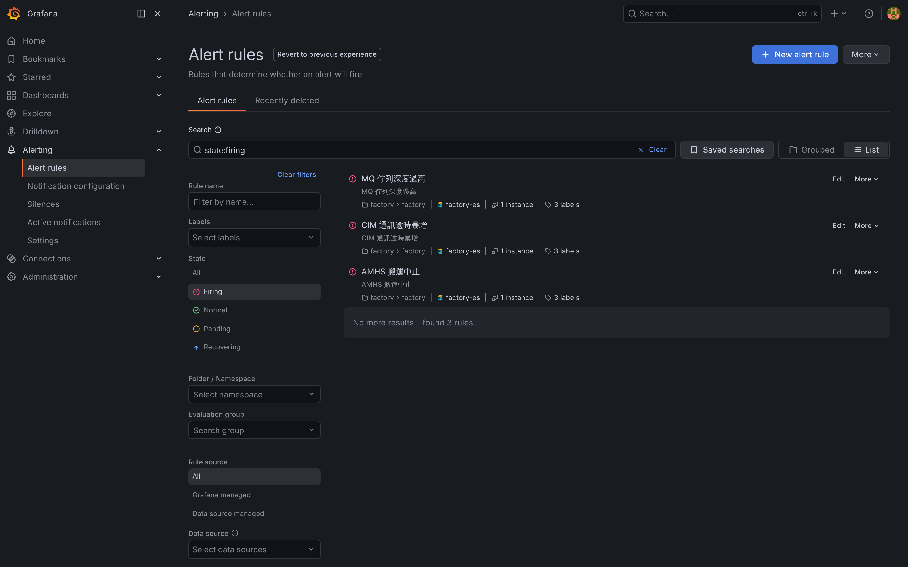
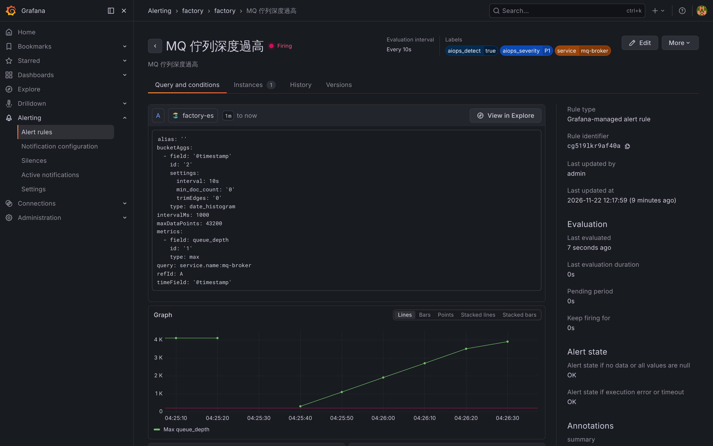
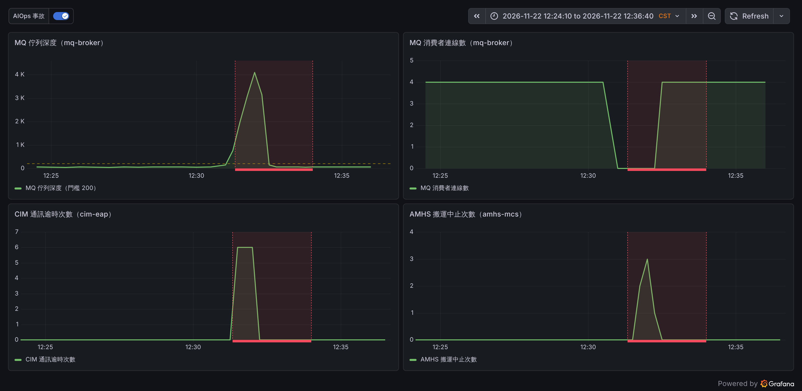
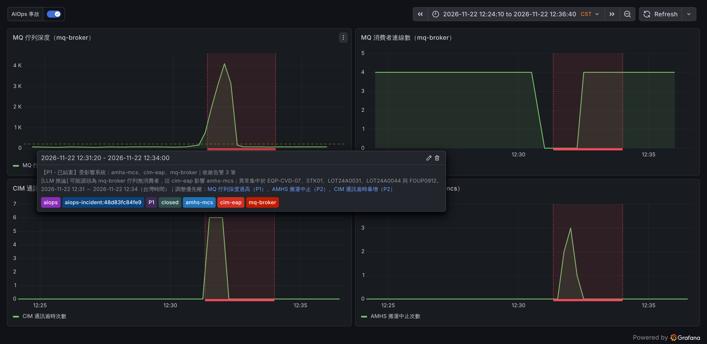
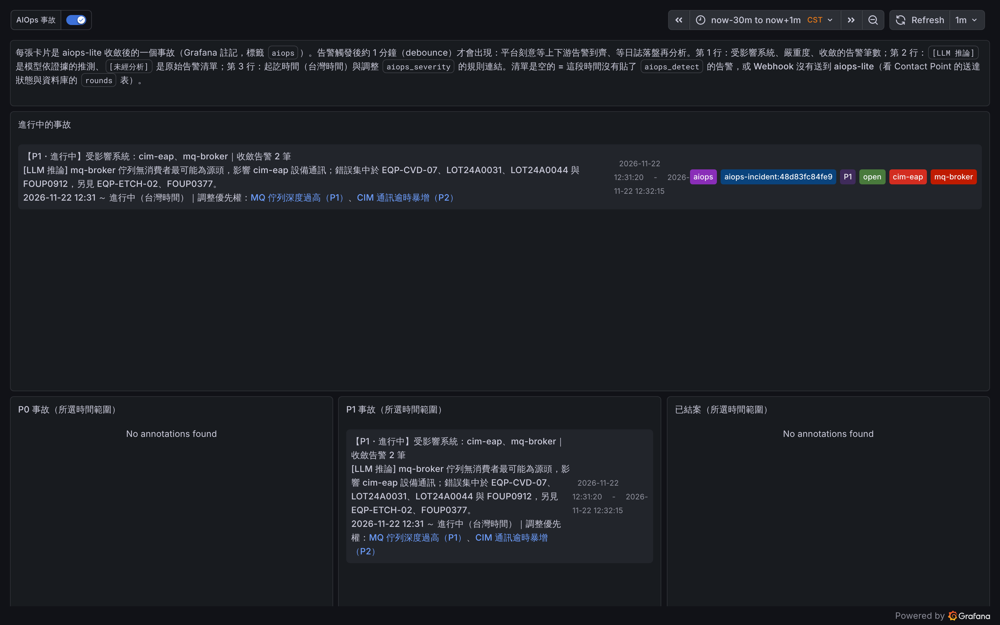
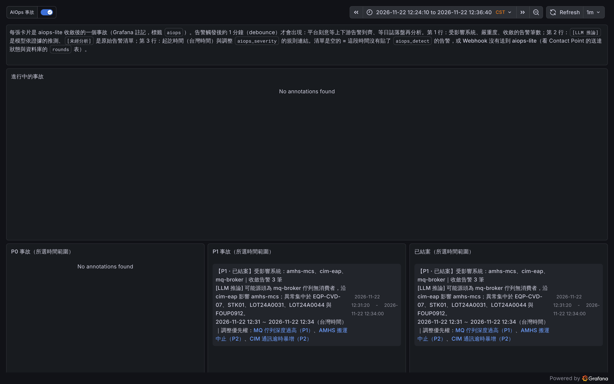

# Demo：Grafana 實際畫面

六張都是**真的 Grafana 13.0.7 的畫面**（Playwright 截圖，2 倍解析度），不是示意圖。
資料是腳本灌的**模擬資料**，圖上的數值不是產線資料。

## 這次 demo 跑了什麼

| 項目 | 內容 |
| --- | --- |
| 元件 | Grafana 13.0.7、Elasticsearch 8.19.23、PostgreSQL 16（aiops-lite 自己的資料庫）、aiops-lite、真的 LLM（OpenAI 相容端點，模型 `gpt-6-luna`） |
| 資料 | 日誌依 `FACTORY_METRICS.md` 的統一欄位規範寫進 ES（`factory-logs-mq`／`-cim`／`-amhs`），ES 先套用文件裡的 index template |
| Grafana 規則 | 3 條，**直接查 ES**，每 10 秒評估一次，看最近 90 秒；都貼了 `aiops_detect=true`、`aiops_severity`、`service` 三個標籤 |
| 通知 | Webhook Contact Point → aiops-lite，Bearer 驗證；路由條件 `aiops_detect = true` |
| aiops-lite 設定 | `debounce_seconds: 45`、`followup_seconds: 20`、`close_after_seconds: 60`，關係邊 `mq-broker → cim-eap → amhs-mcs` |
| 情境 | MQ 佇列堆積且消費者歸零 → CIM 通訊逾時暴增 → AMHS 搬運中止；約 1 分鐘後恢復 |

三條規則：

| 規則 | `service` | 嚴重度 | 查詢 | 觸發條件 |
| --- | --- | --- | --- | --- |
| MQ 佇列深度過高 | `mq-broker` | P1 | `service.name:mq-broker`，欄位 `queue_depth` 取最大值 | 大於 200 |
| CIM 通訊逾時暴增 | `cim-eap` | P2 | `error_type:T3_TIMEOUT` 算筆數 | 大於 5 |
| AMHS 搬運中止 | `amhs-mcs` | P2 | `error_type:TRANSFER_ABORT` 算筆數 | 大於 2 |

門檻是為了 demo 訂的，不是依現場。

---

## 1. 三條規則同時觸發中

Grafana → Alerting → Alert rules，篩選 `state:firing`：

- 三條規則（MQ、CIM、AMHS）都是 Firing，都在資料夾 `factory`，資料源 `factory-es`，每條有 3 個標籤。
- 意義：三個系統的異常都由各系統**自己的 Grafana 規則**判定；aiops-lite 不判斷數值。

## 2. 一條規則的細節：標籤與 ES 查詢

「MQ 佇列深度過高」的規則頁：

- 右上角標籤：`aiops_detect = true`、`aiops_severity = P1`、`service = mq-broker`。**接入 aiops-lite 只需要這三個標籤。**
- 狀態 Firing，每 10 秒評估一次，資料源 `factory-es`。
- 查詢內容：ES 的 `service.name:mq-broker`，對 `queue_depth` 取最大值，每 10 秒一個時間桶。
- 下方圖是規則評估看到的佇列深度：從幾百一路升到約 4K。
- 圖上的時間是 UTC（04:25～04:26），其他圖是台灣時間（12:2x），差 8 小時，是 Grafana 規則預覽頁的顯示方式。

## 3. 指標曲線，事故區間自動疊成紅色

儀表板「AIOps 事件群（指標與事故區間）」（`dashboards/aiops-incident-metrics.json`），時間範圍 12:24:10～12:36:40：

| 面板 | 看到什麼 |
| --- | --- |
| MQ 佇列深度 | 平常約 50～70，事故時衝到約 4,100；虛線是門檻 200 |
| MQ 消費者連線數 | 從 4 掉到 0，恢復後回到 4 |
| CIM 通訊逾時次數 | 事故期間最高 6 次／時間桶 |
| AMHS 搬運中止次數 | 事故期間最高 3 次／時間桶 |

紅色區間是 aiops-lite 寫回的**一筆**事件註記（起訖 12:31:20～12:34:00），四張圖共用同一段。
三個系統的異常在時間上重疊，由同一個事故涵蓋。

## 4. 滑到事故區間：三行摘要與 LLM 推論

滑鼠移到紅色區間下緣，顯示註記內容：

1. **第 1 行（程式產生）**：`【P1・已結案】受影響系統：amhs-mcs、cim-eap、mq-broker｜收斂告警 3 筆`
2. **第 2 行（LLM）**：`[LLM 推論] 可能源頭為 mq-broker 佇列無消費者，沿 cim-eap 影響 amhs-mcs；異常集中於 EQP-CVD-07、STK01、LOT24A0031、LOT24A0044 與 FOUP0912。`
3. **第 3 行（程式產生）**：起訖時間（台灣時間）與三條規則的編輯連結（要調整優先權就改規則的 `aiops_severity` 標籤）

標籤：`aiops`、`aiops-incident:<事故編號>`、`P1`、`closed`、三個系統名稱。

- 第 2 行固定標示 `[LLM 推論]`：它是模型依證據的推測，不是定論。摘要通過了程式的檢查（點名的系統與機台批號都在證據裡）。
- 機台、批號、載具的集中情形來自 ES 錯誤日誌的統計；`STK01` 是 AMHS 日誌裡的設備編號。

## 5. 事件總覽：進行中

儀表板「AIOps 事件總覽」（`dashboards/aiops-overview.json`），事故還在進行中：

- 「進行中的事故」清單有一張卡片：`【P1・進行中】受影響系統：cim-eap、mq-broker｜收斂告警 2 筆`，標籤含 `open`。
- **這張只有 2 個系統**：這次 AMHS 的告警比第一輪分析晚了幾秒才到，之後併入同一張事故並重新分析。第 3、4、6 張是併入後（3 個系統）的結果。這是真實行為，不是修過的圖。
- 第 2 行是當時的 LLM 推論：`mq-broker 佇列無消費者最可能為源頭，影響 cim-eap 設備通訊；錯誤集中於 EQP-CVD-07、LOT24A0031、LOT24A0044 與 FOUP0912，另見 EQP-ETCH-02、FOUP0377。`
- 下方依嚴重度與狀態分成 P0、P1、已結案三個清單。

## 6. 事件總覽：已結案

同一個儀表板，事故結案後：

- 「進行中的事故」清單是空的（`No annotations found`）。
- 這張事故移到 P1 與「已結案」清單，狀態 `closed`，收斂告警 3 筆。
- 結案條件：三條規則都恢復（resolved），再安靜 `close_after_seconds`（這次 60 秒）。

---

## 補充說明

**圖 1、2 與圖 3～6 不是同一次跑出來的。** 圖 3～6 是完整的一次（aiops-lite 在跑，真的 LLM）；
圖 1、2 是另一次簡短的資料注入：同樣的三條規則、同樣的資料格式，但當時沒有啟動 aiops-lite，目的只是讓三條規則同時處於 Firing 以便截圖。

**這次 demo 抓到並修掉一個真實的問題。** 第一次截圖時，結案後的事故還出現在「進行中的事故」清單：Grafana 13.0.7 更新註記的標籤之後，
用舊標籤（`open`）查還是查得到它。現在標籤一變（結案、嚴重度升級、有新系統加入）就刪掉舊註記、建一筆新的；標籤沒變才原地更新。
第 5、6 張是修正後重跑的結果。

**沒有驗證的：**

- 沒有真實產線資料與真實日誌格式；門檻、debounce 等數值要依現場調整。
- LLM 只實測過一個情境、一個模型；摘要是否為真正的根因，要由現場人員判斷。
- 送給 LLM 的日誌樣本沒有遮罩；正式環境要先決定模型的位置與資料能否外送。
- 沒有部署到叢集；這次是在本機拋棄式環境跑的。
- 重現這次 demo 的腳本沒有放進 repo（它們寫死了本機路徑與暫時的環境設定）；環境與規則的設定都寫在上面的表格。
