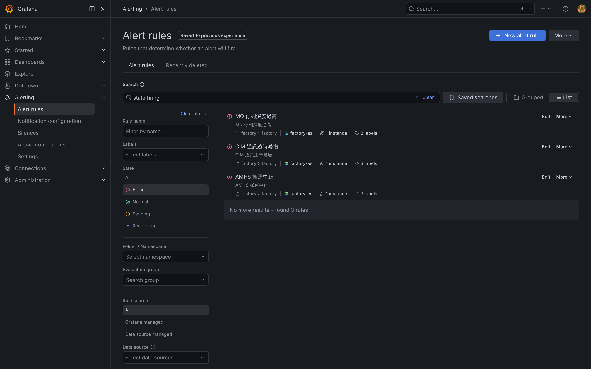
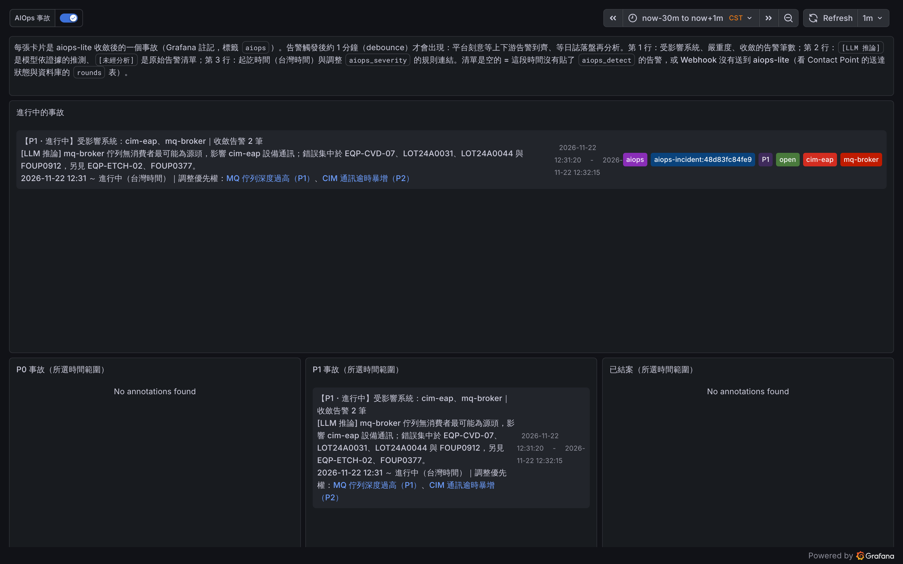
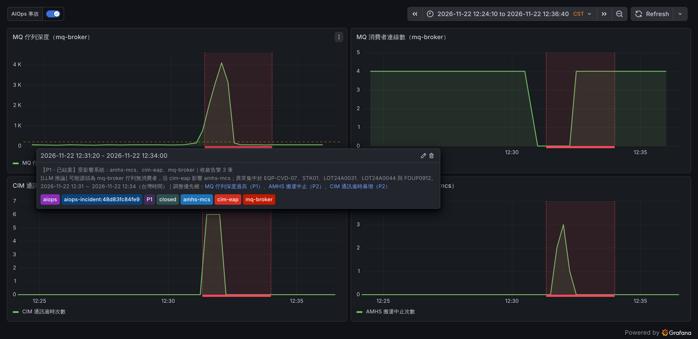
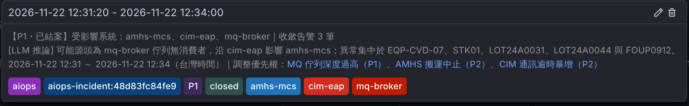
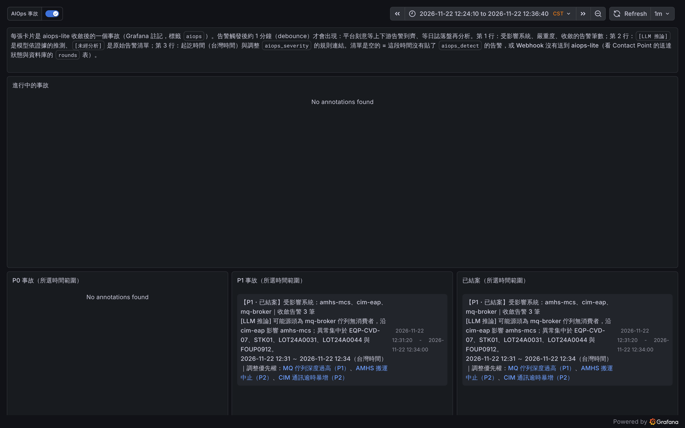

# Demo：Grafana 實際畫面

這幾張都是**真的 Grafana 13.0.7 的畫面**（Playwright 截圖，2 倍解析度）；第 3 張是第 2 張的局部裁切，沒有加工。
資料是腳本灌的**模擬資料**，圖上的數值不是產線資料。

## 一句話串起來

> 以前出事會跳一堆警報（①）；現在系統自動合併，並由 AI 抓出真正源頭（②）；同時直接點名是哪幾台機台與批號卡住，讓工程師立刻能動手修（③）；修好後系統自動結案留紀錄，完全不用人工額外維護（④）。

| # | 重點 | 解決什麼問題 | 圖 |
| --- | --- | --- | --- |
| ① | 跨系統告警收斂（降噪） | 值班人員不會被連鎖告警洗版，一眼就知道這是一起關聯事件 | 1a、1b |
| ② | 根因分析＋LLM 推論（找源頭） | 直接點破「是 MQ 引起 CIM 與 AMHS 異常」，不用再跨系統比對時間軸猜兇手 | 2 |
| ③ | 鎖定異常機台與批號（縮短排查範圍） | 工程師不用去 ES 撈幾千行日誌自己統計，直接拿機台與批號去現場 | 3 |
| ④ | 故障排除後自動結案（全自動閉環） | 不製造額外的「手動關單」負擔，事故紀錄自動留存 | 4 |

---

## ① 跨系統告警收斂（降噪）

**Before：三個系統同時亮紅燈**

Grafana → Alerting → Alert rules，篩選 `state:firing`：MQ、CIM、AMHS 三條規則都在觸發中。
三個系統的異常由各系統**自己的 Grafana 規則**判定（貼了 `aiops_detect`、`aiops_severity`、`service` 三個標籤）；aiops-lite 不判斷數值。
沒有 aiops-lite 時，值班人員會收到這三則獨立的通知。

**After：收斂成一張進行中的事故**

事件總覽儀表板（`dashboards/aiops-overview.json`）：「進行中的事故」只有**一張卡片**，標籤含 `open`，
同一張卡片同時出現在「P1 事故」清單；P0 與已結案清單是空的。

> **這張只有 2 個系統**：這次 AMHS 的告警比第一輪分析晚了幾秒才到，之後併入同一張事故並重新分析。
> 併入後的結果（3 個系統、收斂告警 3 筆）在第 2、3、4 張。這是真實行為，不是修過的圖。

## ② 根因分析＋LLM 推論（找源頭）

> 這幾張是 2026-11-22 實跑的畫面，當時的註記是三行。之後的版本在摘要底下多了「有的證據／缺的證據／還沒接的」幾行，
> 摘要也改成先講結論再講依據；新版的畫面是 `images/5-evidence-lines.png`，說明在 `README.md` 的「註記怎麼讀」。

指標儀表板「AIOps 事件群（指標與事故區間）」（`dashboards/aiops-incident-metrics.json`），時間範圍 12:24:10～12:36:40：

- 四張圖：MQ 佇列深度（事故時衝到約 4,100，平常約 50～70，虛線是門檻 200）、MQ 消費者連線數（從 4 掉到 0 再恢復）、
  CIM 通訊逾時次數、AMHS 搬運中止次數。
- **紅色區間**是 aiops-lite 寫回的**一筆**事件註記（12:31:20～12:34:00），四張圖共用；三個系統的異常在時間上重疊，由同一個事故涵蓋。
- 滑鼠移到紅色區間，跳出**三行摘要**：
  1. 程式產生：`【P1・已結案】受影響系統：amhs-mcs、cim-eap、mq-broker｜收斂告警 3 筆`
  2. LLM：`[LLM 推論] 可能源頭為 mq-broker 佇列無消費者，沿 cim-eap 影響 amhs-mcs；異常集中於 EQP-CVD-07、STK01、LOT24A0031、LOT24A0044 與 FOUP0912。`
  3. 程式產生：起訖時間（台灣時間）與三條規則的編輯連結

第 2 行固定標示 `[LLM 推論]`：它是模型依證據的推測，不是定論；摘要通過了程式的檢查（點名的系統與機台批號都在證據裡）。

## ③ 鎖定異常機台與批號（縮短排查範圍）

第 2 張提示框的局部放大。第 2 行點名的對象：

| 類型 | 點名的對象 |
| --- | --- |
| 機台 | `EQP-CVD-07` |
| 設備（AMHS 日誌裡的搬運設備） | `STK01` |
| 批號 | `LOT24A0031`、`LOT24A0044` |
| 載具 | `FOUP0912` |

這些來自 ES 裡事故時間窗內**錯誤日誌的欄位統計**（`eqp_id`、`lot_id`、`carrier_id` 的出現次數），由程式統計後交給 LLM，
不是模型自己猜的；模型點名的對象如果不在證據裡，整段摘要會被退回，改顯示 `[未經分析]` 的原始摘要。

要注意：「集中在哪台機台」是**錯誤日誌的計數**，指出該先去看哪裡，不代表那台機台就是根因。

## ④ 故障排除自動結案（全自動閉環）

三條規則都恢復後，同一個儀表板：

- 「進行中的事故」清單變空（`No annotations found`）。
- 這張事故移到 P1 與「已結案」清單，狀態 `closed`，收斂告警 3 筆，註記保留完整的三行摘要與起訖時間。
- 結案條件：所有成員告警都恢復（resolved），再安靜 `close_after_seconds`（這次 60 秒）；期間又響就同一張事故繼續。
- 全程沒有人工關單；註記留在 Grafana，之後可以依時間範圍、嚴重度、系統名稱查回來。

---

## 這次 demo 跑了什麼

| 項目 | 內容 |
| --- | --- |
| 元件 | Grafana 13.0.7、Elasticsearch 8.19.23、PostgreSQL 16（aiops-lite 自己的資料庫）、aiops-lite、真的 LLM（OpenAI 相容端點，模型 `gpt-6-luna`） |
| 資料 | 日誌依 `README.md` 第 9 節的統一欄位規範寫進 ES |
| Grafana 規則 | 3 條，直接查 ES，每 10 秒評估一次，看最近 90 秒 |
| 通知 | Webhook Contact Point → aiops-lite（Bearer 驗證）；路由條件 `aiops_detect = true` |
| aiops-lite 設定 | `debounce_seconds: 45`、`followup_seconds: 20`、`close_after_seconds: 60`，關係邊 `mq-broker → cim-eap → amhs-mcs` |
| 情境 | MQ 佇列堆積且消費者歸零 → CIM 通訊逾時暴增 → AMHS 搬運中止；約 1 分鐘後恢復 |

| 規則 | `service` | 嚴重度 | 查詢 | 觸發條件 |
| --- | --- | --- | --- | --- |
| MQ 佇列深度過高 | `mq-broker` | P1 | `service.name:mq-broker`，`queue_depth` 取最大值 | 大於 200 |
| CIM 通訊逾時暴增 | `cim-eap` | P2 | `error_type:T3_TIMEOUT` 算筆數 | 大於 5 |
| AMHS 搬運中止 | `amhs-mcs` | P2 | `error_type:TRANSFER_ABORT` 算筆數 | 大於 2 |

門檻是為了 demo 訂的，不是依現場。

## 補充說明

**第 1a 張與其他張不是同一次跑出來的。** 第 1a 張是另一次簡短的資料注入：同樣的三條規則、同樣的資料格式，
但當時沒有啟動 aiops-lite，目的只是讓三條規則同時處於觸發中以便截圖。第 1b、2、3、4 張來自同一次完整的跑（aiops-lite 在跑、真的 LLM）。

**這次 demo 抓到並修掉一個真實的問題。** 第一次截圖時，結案後的事故還出現在「進行中的事故」清單：Grafana 13.0.7 更新註記的標籤之後，
用舊標籤（`open`）查還是查得到它。現在標籤一變（結案、嚴重度升級、有新系統加入）就刪掉舊註記、建一筆新的；標籤沒變才原地更新。
第 1b、4 張是修正後重跑的結果。

**沒有驗證的：**

- 沒有真實產線資料與真實日誌格式；門檻、debounce 等數值要依現場調整。
- LLM 只實測過一個情境、一個模型；摘要是否為真正的根因，要由現場人員判斷。
- 送給 LLM 的日誌樣本沒有遮罩；正式環境要先決定模型的位置與資料能否外送。
- 沒有部署到叢集；這次是在本機拋棄式環境跑的。
- 重現這次 demo 的腳本沒有放進 repo（它們寫死了本機路徑與暫時的環境設定）；環境與規則的設定都寫在上面的表格。
